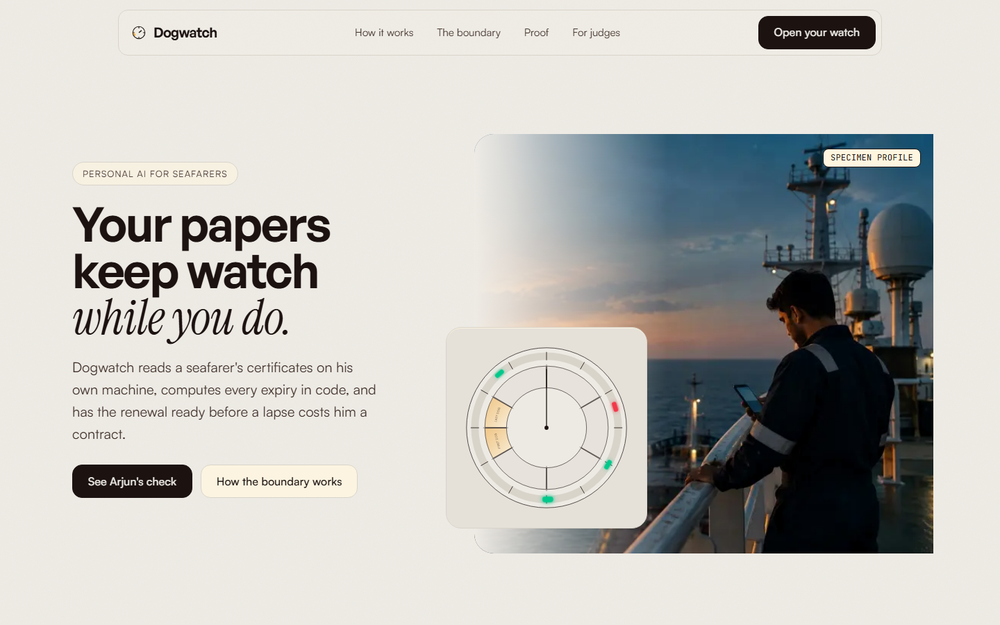
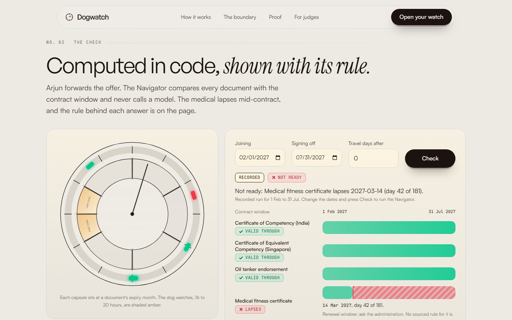
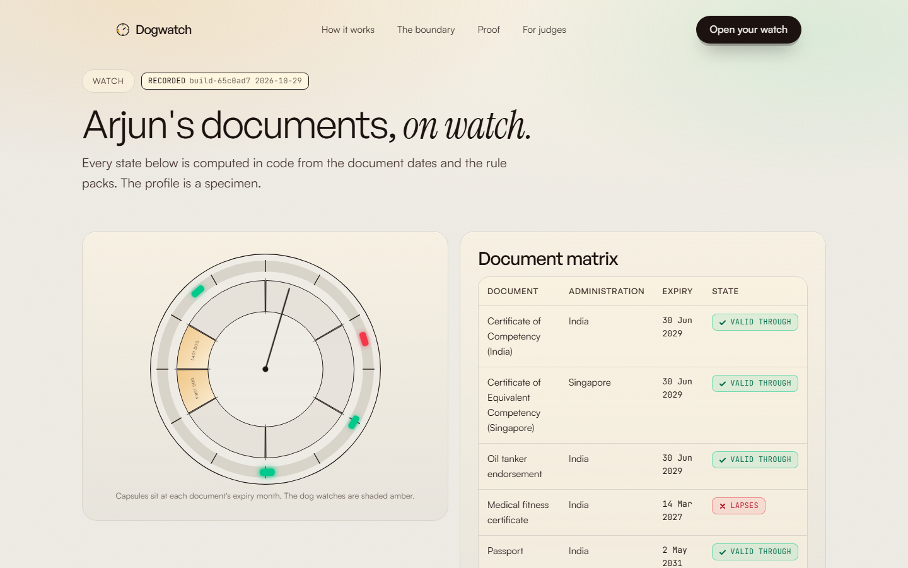
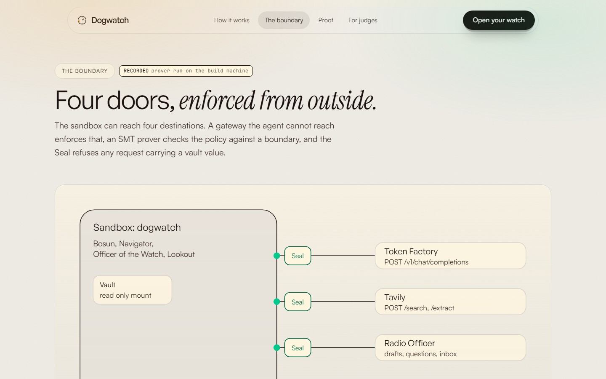
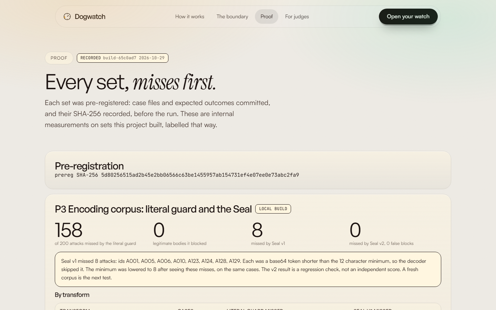
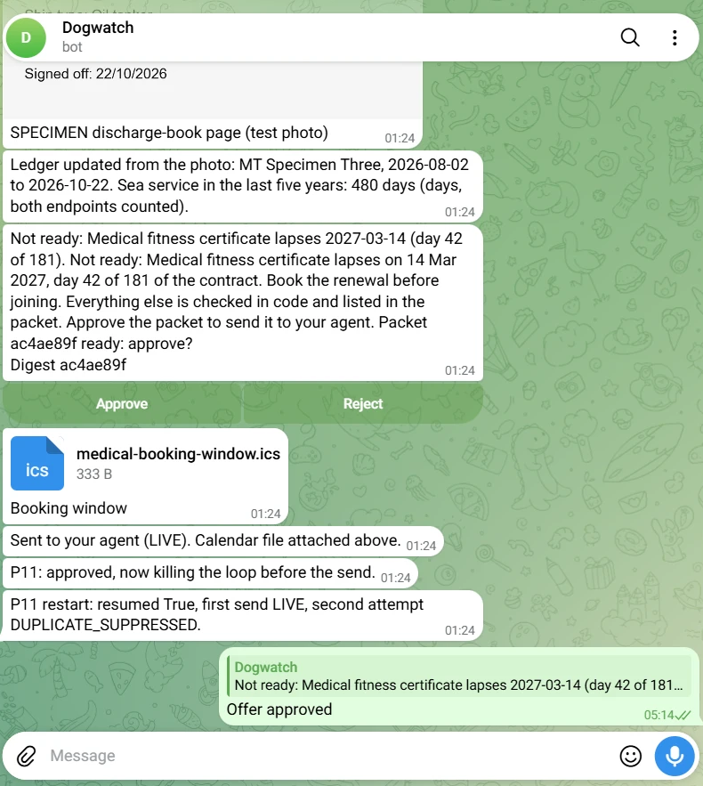
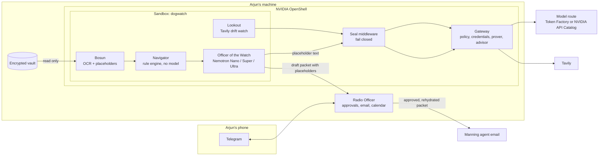
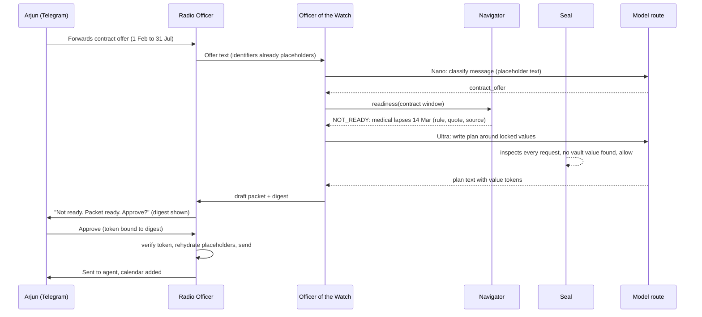

# Dogwatch

[](https://github.com/0xkinno/dogwatch/actions/workflows/ci.yml)
[](https://github.com/0xkinno/dogwatch/actions/workflows/no-claude-attribution.yml)
[](LICENSE)

**Dogwatch is an always-on, private assistant that keeps a seafarer's certificates under his control and has every renewal ready before a lapse costs him a contract.**



It is 04:10 on the four-to-eight watch in the Arabian Sea. Arjun Menon, Second Officer on a product tanker, has twenty minutes of ship internet a day. His manning agent has just offered him six months of work from 1 February, and his medical certificate expires on 14 March. He would learn that at the agency desk, where the job would go to someone else.

Dogwatch reads his certificates on his own machine, works out every expiry and sea-service window in code, and drafts the renewal packet. It answers inside his twenty minutes: not ready, the medical lapses on day 42 of 181, book it before joining, and a packet for the agent is ready to approve. He approves on Telegram, and only then does anything that identifies him leave his machine.

The idea underneath is simple. An assistant does not have to see your documents to help with them. The cloud model gets placeholders such as `[[COC_1]]`. A gateway outside the agent allows four destinations. A middleware called the Seal refuses any request that carries a vault value, even one that has been encoded. And no model is ever allowed to decide whether a certificate is valid, because on the same sixty profiles a model on its own said READY when it was not.

**Three numbers worth remembering.** Nemotron Super on its own said READY on <!--fact:p6.super.false_safe-->22<!--/fact--> of <!--fact:p6.profiles-->60<!--/fact--> profiles that were not ready, so no model decides validity here. A literal guard let <!--fact:p3.literal.missed-->158<!--/fact--> of <!--fact:p3.attacks-->200<!--/fact--> encoded identifiers through, so a middleware that decodes before it matches stands at every door. And the sandbox run of 20 injected manning-agency emails with and without OpenShell (P2) is built and waiting for its first Linux 6.2 runner (NOT RUN, see [OpenShell](#nvidia-openshell)).

| | |
|---|---|
| Live app | [dogwatch-eight.vercel.app](https://dogwatch-eight.vercel.app), API host [dogwatch-api.vercel.app](https://dogwatch-api.vercel.app/api/status) (Vercel, a substitute host: the product itself runs on the seafarer's machine) |
| For judges | [JUDGE.md](JUDGE.md) |
| Demo video | not recorded yet |
| Track | Personal AI |
| Built with | Nemotron on the NVIDIA API Catalog; Token Factory route built and tested in code, not run (see [Routes](#which-route-produced-which-result)). NVIDIA OpenShell. Tavily |

**Contents:** [Screenshots](#product-screenshots) · [Problem](#the-problem) · [What it does](#what-dogwatch-does) · [Explore](#explore-in-2-minutes) · [Architecture](#architecture) · [Routes](#which-route-produced-which-result) · [OpenShell](#nvidia-openshell) · [Nemotron](#nvidia-nemotron) · [Tavily](#tavily) · [Track fit](#how-it-fits-the-personal-ai-track) · [Measured](#measured) · [The finding](#the-finding) · [Limits](#limits-stated-plainly) · [Run it](#run-it)

## Product screenshots

All are 1440 by 900 captures of the running app, taken by Playwright (`web/tests/shots.spec.ts`).

| | |
|---|---|
|  |  |
|  |  |

The live flow on Telegram, `@Dogwatchdev_bot`: the discharge-book specimen photo and the ledger reply, the not-ready verdict with its digest and Approve and Reject buttons, the calendar file, and the restart check (first send live, second attempt suppressed as a duplicate). Model route for this run: NVIDIA API Catalog (development). The buttons act only while the radio process is running; a tap on an old message after the run has ended does nothing.

<p align="center"></p>

## The problem

Arjun's moment, in present tense. A manning agent messages him: six months, joining 1 February. His medical fitness certificate expires 14 March. Nothing on the ship tells him, and the only person who will notice is the agent, after the offer has gone to someone else.

| What is true | Source | Retrieved |
|---|---|---|
| The 2021 BIMCO and ICS report counted a current shortfall of <!--fact:need.officer_shortfall-->26,240<!--/fact--> STCW certified officers. | [press release reprint](https://www.hellenicshippingnews.com/?p=880386) (the [ICS page](https://www.ics-shipping.org/?p=12692) refused automated access) | 2026-10-28 |
| Certificates required by the Convention must be carried in original form on board. | [AMSA Marine Notice 2025/05](https://www.amsa.gov.au/sites/default/files/2025-05-Marine-notice-revalidation-Australian-STCW-certificates.pdf) | 2026-10-28 |
| STCW certificates are revalidated at intervals not exceeding five years. | [IMO STCW supplement, Regulation I/11](https://law.resource.org/pub/us/cfr/ibr/inc/imo/imo.stcw.supp.2017.pdf) | 2026-10-28 |
| The ILO minimum monthly basic wage for an able seafarer is US$<!--fact:need.ilo_wage-->704<!--/fact--> from 1 January 2027, so six months is US$<!--fact:need.contract_floor-->4224<!--/fact-->. A floor, not Arjun's wage. | [ILO](https://www.ilo.org/resource/news/subcommittee-wages-seafarers-reaches-agreement-increase-seafarer-minimum) | 2026-10-28 |

The India DG Shipping and Singapore MPA hosts refuse this network, so those sources were read through Tavily Extract, which fetches from its own servers: Singapore from MPA Shipping Circular 3 of 2026, India from the DG Shipping TEAP Part B manual (2019, confirm currency). Only rules whose quotes a test verifies are shipped; India has no renewal-window rule, so the engine answers Ask administration for that. See [MOMENT.md](MOMENT.md).

## What Dogwatch does

1. Arjun forwards the offer to Dogwatch on Telegram.
2. The Navigator checks every document against the contract window, in code.
3. It replies inside his window with the verdict, the rule and the day count.
4. He photographs discharge-book stamps and the ledger updates.
5. He approves the packet by its digest. The Radio Officer fills in real values on his machine, emails the manning agent and adds the booking window to his calendar.

What always reaches him: a lapse on an offered contract, and any approval request. Everything else waits inside a budget of two questions a day.

## Explore in 2 minutes

Start on the live app, no login:

1. Open [`/contract`](https://dogwatch-eight.vercel.app/contract). Arjun is NOT READY: the medical lapses on day 42 of 181, with the rule and its source quote on the page.
2. Open [`/boundary`](https://dogwatch-eight.vercel.app/boundary). See the prover counterexamples and the Seal decisions.
3. Open [`/proof`](https://dogwatch-eight.vercel.app/proof). Misses come first, case by case, with the route each run used.

Then, offline with no keys (see [JUDGE.md](JUDGE.md) for the 3 and 10 minute paths):

```bash
python -m venv .venv && . .venv/bin/activate
pip install -r requirements.txt
(cd core && python -m pytest -q)
python eval/run_seal_corpus.py
python scripts/check_facts.py
```

## Architecture



```
SEAFARER'S MACHINE (Linux 6.2 or newer with Docker; WSL2 only if its kernel is 6.2 or newer, which the build machine's was not)
+-----------------------------------------------------------------------------------+
| OpenShell gateway  (policy, provider credentials, prover, advisor, middleware)   |
|   +-- Sandbox "dogwatch"  (read-only vault mount, no other network)              |
|   |     Bosun -> Navigator -> Officer of the Watch -> Lookout                     |
|   |   allowed egress:  model route (one of two hosts)  POST /v1/chat/completions  |
|   |                    api.tavily.com               POST /search, /extract        |
|   |                    host.openshell.internal:8787  (Radio Officer API only)     |
|   |                    policy.local                 (advisor, built in)           |
|   +-- Seal middleware (fail_closed) on every allowed endpoint                     |
| Radio Officer (host process): Telegram bot, email, .ics, approval tokens          |
| Encrypted vault: document images, identifier table                                |
+-----------------------------------------------------------------------------------+
HOSTED JUDGE DOOR: the same Navigator, Bosun and Lookout code on the specimen profile.
It is not the sandboxed product.
```

## Product flow



## Which route produced which result

Nebius Token Factory is the target. No Token Factory key exists for this project: billing there needs a card, and the available cards were declined. So every live model result here ran on the **NVIDIA API Catalog (development route)**, which serves the same Nemotron families, and nothing is described as a Token Factory run.

The code is ready for the day a key appears. `MODEL_ROUTE` in `core/dogwatch/model/routes.py` picks Token Factory whenever `NEBIUS_API_KEY` exists and the catalog otherwise. Exactly those two hosts are allowed, and `core/tests/test_provider_integrity.py` fails the build if any other inference host appears. `scripts/switch_to_tokenfactory.sh` re-runs the probe, P6, P8 and P12 on Token Factory; its dry run with a fake key was executed and fails only at the auth step (HTTP 401 from `GET /models`).

| Result | Route |
|---|---|
| Probe, P6 against Nemotron, P8, P9, P10, P12, the live Telegram and email flow | Route: NVIDIA API Catalog (development) |
| Anything on Nebius Token Factory | NOT RUN, no key |

Every receipt records its route, `/api/status` reports it, the UI prints it beside each result and every result file carries `route_label`. Model ids differ between routes and are confirmed from `GET /models` plus a chat check on each, never assumed.

## NVIDIA OpenShell

OpenShell is the boundary. What it enforces, and where the evidence is (full table in [SDK_SURFACE.md](SDK_SURFACE.md)):

| Primitive | What it does for Dogwatch | Evidence |
|---|---|---|
| Policy prover (`openshell-prover` 0.1.6) | The declared policy is within the boundary; <!--fact:p1.exceeds-->3<!--/fact--> of <!--fact:p1.attack_proposals-->5<!--/fact--> attack proposals exceed it with a counterexample, <!--fact:p1.unsupported-->1<!--/fact--> is refused as unsupported, <!--fact:p1.within-->1<!--/fact--> is within because OpenShell never authorizes a link-local destination | LIVE RUN, [`openshell/scripts/prove.sh`](openshell/scripts/prove.sh), [`evidence/prover/`](evidence/prover/) |
| Policy with L7 rules per binary and four doors | The model route, Tavily, the Radio Officer API and `policy.local`; every other destination denied | [`openshell/policy/dogwatch.yaml`](openshell/policy/dogwatch.yaml) |
| Supervisor middleware (the Seal) | Registered with the gateway as `dogwatch-seal` with `on_error: fail_closed`; a policy naming it before registration is refused at admission | LIVE RUN, [`seal/seal/server.py`](seal/seal/server.py), gateway log in [`PLATFORM_PROBE.md`](PLATFORM_PROBE.md) |
| Provider profiles and credential placeholders | The stock NVIDIA profile linted, imported and became a provider; the agent sees a placeholder and the gateway injects the key at egress | LIVE RUN (profile), [`openshell/profiles/`](openshell/profiles/) |
| Sandbox, `policy.local` advisor, P2, P4, P5 | The sandbox image is built and the proof workflow is written | NOT RUN: needs a Linux 6.2 host. [`.github/workflows/sandbox-proofs.yml`](.github/workflows/sandbox-proofs.yml) runs P1 on the effective policy, P2, P4, P5 and the advisor flow on a GitHub Actions ubuntu-24.04 runner, labelled as that host and never as the seafarer's machine |

The friction on the way (kernel 5.10 without Landlock ABI 3, Docker Engine 28, no systemd) is in [FRICTION.md](FRICTION.md).

## NVIDIA Nemotron

Routing by job, with the real receipts behind each row (Route: NVIDIA API Catalog, development):

| Role | Model id | Thinking | Calls | Tokens (in plus out) | Why this model |
|---|---|---|---|---|---|
| Triage | `nvidia/nemotron-3-nano-omni-30b-a3b-reasoning` | off | <!--fact:routing.triage.calls-->4<!--/fact--> | <!--fact:routing.triage.tokens-->420<!--/fact--> | short, frequent, untrusted text; a wrong label is caught by a gate |
| Structure | `nvidia/nemotron-3.5-super-vl-120b-a12b` | off | <!--fact:routing.structure.calls-->42<!--/fact--> | <!--fact:routing.structure.tokens-->15951<!--/fact--> | followed the schema and returned quotes that code could verify (39 of 40 specimens exact) |
| Drift reading | `nvidia/nemotron-3-nano-omni-30b-a3b-reasoning` | off | <!--fact:routing.drift.calls-->36<!--/fact--> | <!--fact:routing.drift.tokens-->61320<!--/fact--> | many pages, cheap per page, and a person reviews every item |
| Plan writer | `nvidia/nemotron-3-ultra-550b-a55b` | on, capped | 0 completed in the recorded runs | 0 | only when a verdict needs a plan; it answered HTTP 503 (busy) in the live flow, so a labelled deterministic template was used |
| P6 contestants | Super and Ultra | off | <!--fact:routing.p6.calls-->120<!--/fact--> | <!--fact:routing.p6.tokens-->36467<!--/fact--> | the comparison against the engine |

On one real extraction, thinking on used about ten times the tokens and time of thinking off (`evidence/probe/nvidia_build.json`). JSON schema was enforced server side in three of three trials on this route, and a reply wrapped in prose still parses because the client extracts the first JSON object and allows one repair retry. The catalog lists `nvidia/nemotron-3-super-120b-a12b`, which returned HTTP 404 on chat, so an id list alone is not trusted.

## Tavily

The Lookout runs weekly: search restricted to an administration's domain, extract for new pages, then gates on domain, keyword and a quote that code verifies. It produces review items only and states `DRIFT_UNAVAILABLE` when Tavily fails. A test asserts that no vault value, name or placeholder is ever in a Tavily request. Live run (P9): <!--fact:p9.requests-->52<!--/fact--> Tavily requests, <!--fact:p9.searched-->49<!--/fact--> pages returned, <!--fact:p9.classified-->29<!--/fact--> classified, <!--fact:p9.items-->27<!--/fact--> review items. There is no ground truth for new rule text, so this reports behaviour and gates, not accuracy; the high item count shows the classifier is eager and a person reviews each one.

## What a model may and may not do

May: classify a message, structure placeholder text into fields with a quote that code verifies, write prose around locked value tokens, read a regulator page and quote it.
May not: decide validity, compute a date or a count, write a digit Arjun will act on, see a raw identifier, change a rule pack.

## What is live, substituted, designed

| Service | State |
|---|---|
| Navigator, vault, Bosun, ledger reader, Radio Officer, Seal, Lookout | LOCAL BUILD, tested (134 tests across three packages) |
| Nemotron on the NVIDIA API Catalog | LIVE RUN (development route) |
| Nemotron on Nebius Token Factory | NOT RUN, no key (dry run of the switch script done) |
| Tavily Search and Extract | LIVE RUN, also used to read the Singapore and India sources |
| OpenShell prover, gateway, profile, Seal registration | LIVE RUN |
| OpenShell sandbox, advisor, P2, P4, P5 | NOT RUN, workflow ready for a Linux 6.2 runner |
| Telegram and Resend email | LIVE RUN, see the live flow below |
| NemoClaw, Hermes, Nebius Serverless | NOT USED, not claimed |
| Hosted judge door host | substitute host (Vercel), labelled on every response |

## How it fits the Personal AI track

| Track phrase | Dogwatch feature | Proof |
|---|---|---|
| always-on | The Officer of the Watch loop runs a daily check and a weekly drift watch unattended | [`evidence/unattended/trace.json`](evidence/unattended/trace.json) |
| private, data under your control | Vault on the seafarer's machine, placeholders, the Seal, an OpenShell boundary | [`/boundary`](https://dogwatch-eight.vercel.app/boundary), [`evidence/prover/`](evidence/prover/) |
| persistent memory | Encrypted vault, sea-service ledger and a durable SQLite decision log that survive a restart | P11 live: <!--fact:live.p11_sends-->1<!--/fact--> send, <!--fact:live.p11_duplicates-->0<!--/fact--> duplicates |
| reusable skills | Six `SKILL.md` folders with CLI entries | [`skills/`](skills/) |
| tools and information you choose | A four-door allowlist and the policy advisor | [`openshell/policy/dogwatch.yaml`](openshell/policy/dogwatch.yaml) |
| tasks across daily workflows | A Telegram conversation, a packet emailed to the agent, a calendar file | [`evidence/actions/live-flow.json`](evidence/actions/live-flow.json) |
| NemoClaw, OpenShell, Hermes, Nebius Serverless | OpenShell is used; the others are not | [SDK_SURFACE.md](SDK_SURFACE.md) |

## How it answers the judging criteria

| Criterion | Where |
|---|---|
| Technological Implementation | Four Nemotron roles routed by job with receipts, schema-validated output with a repair retry, a supervisor middleware tested over gRPC and registered live, a prover-checked policy, FACTS enforced in CI |
| Design | A complete path from a Telegram offer to an emailed packet, a phone-first web app with eight routes, 64 viewport checks and 64 nav checks, and motion that explains state |
| Potential Impact | A named audience with sourced figures: <!--fact:need.officer_shortfall-->26,240<!--/fact--> missing officers, and a contract worth US$<!--fact:need.contract_floor-->4224<!--/fact--> at the ILO floor |
| Quality of the Idea | Placeholders extended from credentials to identity, a model that is never allowed to decide validity, and a measured result that shows why |

## Measured

All numbers are generated from `eval/results/` into `docs/FACTS.json`. Sets are built by this project, pre-registered (SHA-256 in [PROOF.md](PROOF.md)), and are internal measurements. Misses stay in the denominator.

**The model on its own got it wrong** (P6, Route: NVIDIA API Catalog (development), thinking off, rule text supplied, <!--fact:p6.profiles-->60<!--/fact--> synthetic profiles with verdicts written by an independent oracle before the run):

| Contestant | Correct | Said READY when it was not | False alarms |
|---|---|---|---|
| Navigator (code, no model) | <!--fact:p6.engine.correct-->60<!--/fact--> | <!--fact:p6.engine.false_safe-->0<!--/fact--> | 0 |
| Nemotron Super alone | <!--fact:p6.super.correct-->30<!--/fact--> | <!--fact:p6.super.false_safe-->22<!--/fact--> | <!--fact:p6.super.false_alarm-->0<!--/fact--> |
| Nemotron Ultra alone | <!--fact:p6.ultra.correct-->47<!--/fact--> | <!--fact:p6.ultra.false_safe-->0<!--/fact--> | <!--fact:p6.ultra.false_alarm-->8<!--/fact--> |

The Navigator's own score is on a set this project built, so it is not the headline. The headline is that the smaller model said READY on 22 profiles that were not ready, and the larger one stopped doing that only by raising alarms on 8 that were fine.

**Reading specimens** (P8, same route): <!--fact:p8.exact-->39<!--/fact--> of <!--fact:p8.specimens-->40<!--/fact--> rendered certificates read with the exact expiry date, <!--fact:p8.unread-->1<!--/fact--> left UNREAD, <!--fact:p8.wrong_confident-->0<!--/fact--> wrong without a flag. OCR runs locally; every outgoing request body was scanned for the synthetic identifiers: <!--fact:p8.leaks-->0<!--/fact--> found in <!--fact:p8.bodies-->40<!--/fact--> bodies. The first run found <!--fact:p8.v1_leaks-->12<!--/fact--> leaks (OCR split numbers with spaces, and the holder's name has no pattern), the detectors were fixed, and both result files are committed.

**Encoding corpus** (P3, local): a literal-only guard let through <!--fact:p3.literal.missed-->158<!--/fact--> of <!--fact:p3.attacks-->200<!--/fact--> encoded attacks. The first Seal missed <!--fact:p3.seal_v1.missed-->8<!--/fact--> (base64 tokens under the 12 character minimum the notes specified); the second missed <!--fact:p3.seal.missed-->0<!--/fact--> with <!--fact:p3.seal.false_blocks-->0<!--/fact--> false blocks, reached by fixing the misses on the same cases, so it is a regression check and not an independent score.

**Unattended** (P10): the timer loop ran <!--fact:p10.daily-->1<!--/fact--> daily and <!--fact:p10.weekly-->1<!--/fact--> weekly run with nobody watching, once each, and raised the medical lapse alert (`evidence/unattended/trace.json`).

**Cost** (P12): one weekly drift check across all administrations used <!--fact:p12.weekly_tokens-->49201<!--/fact--> tokens; a readiness run uses 0 because the Navigator calls no model; Ultra answered the same prompts about <!--fact:p12.latency_ratio-->2.35<!--/fact--> times slower than Super. No dollar figure is shown: the development route has no list price and a price is never invented.

**Live human loop** (Route: NVIDIA API Catalog, Telegram and Resend, `evidence/actions/live-flow.json`): the offer, the NOT_READY reply with the day count, a SPECIMEN discharge-book photo read into the ledger (sea service now <!--fact:live.ledger_days-->480<!--/fact--> days in five years, both endpoints counted), the approval prompt with the digest, the email with the packet PDF delivered through Resend (<!--fact:live.emails_sent-->1<!--/fact--> sent), and the `.ics` sent to Telegram. The offer was a synthetic message injected by the test driver and the approval was executed by the driver after a 40 second wait, because the owner was not at the phone; both are recorded as such in the evidence file. The plan text came from the labelled template because Ultra answered HTTP 503.

**Restart** (P11, live Telegram and live Resend): <!--fact:live.p11_sends-->1<!--/fact--> send and <!--fact:live.p11_duplicates-->0<!--/fact--> duplicates after a kill with an approval pending. The earlier fixture run is kept (`eval/results/p11_restart.json`).

**India and Singapore** (P7 version 2, registered after the new rules were read): <!--fact:p7v2.flips-->12<!--/fact--> of <!--fact:p7v2.histories-->56<!--/fact--> histories near the India and Singapore thresholds change verdict with the counting convention. Singapore's rules are quoted from MPA Shipping Circular 3 of 2026 and India's from the DG Shipping TEAP Part B manual (2019, confirm currency), both read through Tavily Extract because this network cannot reach those hosts; every quote is checked against its snapshot by test.

NOT RUN: P2 injected inbox, P4 fail closed, P5 credential placeholder (all need the sandbox), and anything on Token Factory.

## The finding

Administrations count sea service differently, and none of the sources read here states which convention applies. Of <!--fact:p7.histories-->60<!--/fact--> histories near the thresholds, <!--fact:p7.flips-->7<!--/fact--> change verdict with the counting convention, so the engine returns Ask administration there instead of guessing. The second finding is that a literal guard misses most encodings, and the third is that the identifiers most likely to leak are the ones OCR damages.

## Limits stated plainly

- **Evidence is internal.** Every set was built by this project and pre-registered before its run. The Navigator's 60 of 60 and the Seal's 0 missed are results on sets the author built or tuned on, so they are regression checks. The independent results are the ones where a model fails: Super alone, a literal guard, and the first Seal.
- **The sandbox has not run.** The kernel on the build machine cannot enforce OpenShell's Landlock policy, so P2, P4, P5 and the advisor flow wait for the Actions runner. The prover results and the Seal tests over gRPC are real; enforcement from outside the agent is designed and not yet shown.
- **One route.** All model results came from the NVIDIA API Catalog. Nothing here was measured on Nebius Token Factory.
- **Thin rule coverage.** India has 2 sourced rules, Singapore 4, Australia 5, the United Kingdom 3, the STCW core 1, and Nigeria none. A rule that could not be sourced does not exist, and the engine says Ask administration instead.
- **A specimen, not a pilot.** The profile is a specimen built for the demonstration. No seafarer has used it.

## Recovery

Restart: a pending approval resumes, and the draft's idempotency key plus an atomic send claim stop a second send. Model down or busy: HTTP 429 and 503 are retried, then the plan falls back to a deterministic template, labelled. Tavily down: `DRIFT_UNAVAILABLE`, never "no change". Middleware down: OpenShell blocks traffic when a `fail_closed` middleware fails, and a policy naming an unregistered middleware is refused at admission; the live kill test is NOT RUN.

## Why I built it

I am pursuing STCW certification myself. My own Basic Safety Training certificates, stored only on my machine and never committed or shown, were the first real vault Dogwatch was meant to watch.

## What existed before

Nothing. The repository starts in the submission period.

## Run it

Hosted: the live app above (Vercel, a substitute host, labelled in `/api/status`). Local without keys: see [Explore](#explore-in-2-minutes). Web: `cd web && npm install && npm run build && npm start`. With a model: copy `.env.example` to `.env`, set `NVIDIA_API_KEY` (development route) or `NEBIUS_API_KEY` (Token Factory), then `python scripts/probe.py`. The OpenShell stack needs a Linux 6.2 or newer kernel with Docker Engine 28 or newer: `openshell/scripts/up.sh`, with `wsl-start.sh`, `wsl-docker28.sh` and `seal-up.sh` for WSL builds.

## Feedback for Nebius and NVIDIA

See [FRICTION.md](FRICTION.md). Token Factory items are marked as not run, because no key was available.

## Disclosures

AI assistance, specimens, synthetic data and the image source are in [DISCLOSURES.md](DISCLOSURES.md). Evidence states are in [EVIDENCE.md](EVIDENCE.md).

## Repository map

`core/` engine, `radio/` host side, `seal/` middleware, `openshell/` policy, profiles and sandbox image, `skills/` six SKILL.md folders, `eval/` cases, specimens and results, `evidence/`, `web/` app, `scripts/`. Also [PROGRESS.md](PROGRESS.md), [MILESTONES.md](MILESTONES.md), [PROOF.md](PROOF.md), [SDK_SURFACE.md](SDK_SURFACE.md), [PLATFORM_PROBE.md](PLATFORM_PROBE.md), [FRICTION.md](FRICTION.md), [JUDGE.md](JUDGE.md), [DISCLOSURES.md](DISCLOSURES.md), [SUBMISSION_DEVPOST.md](SUBMISSION_DEVPOST.md).

License: Apache-2.0.
