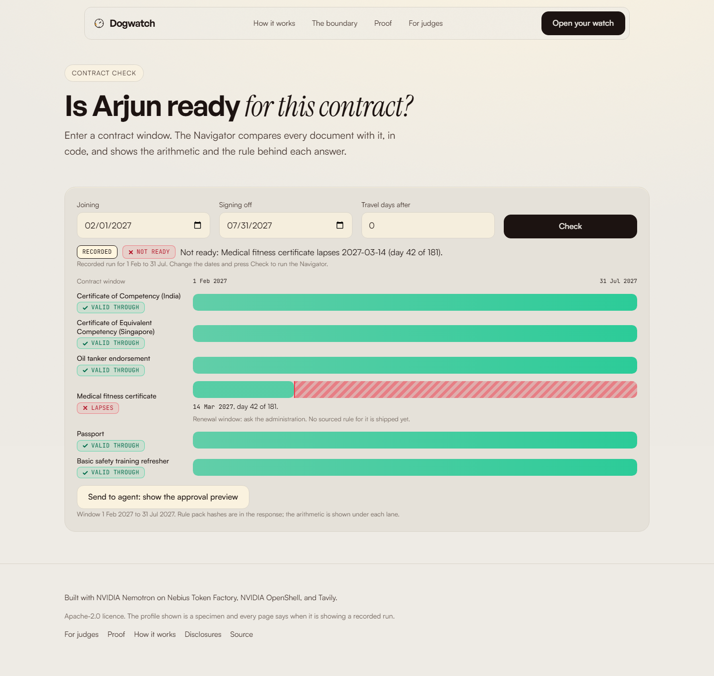
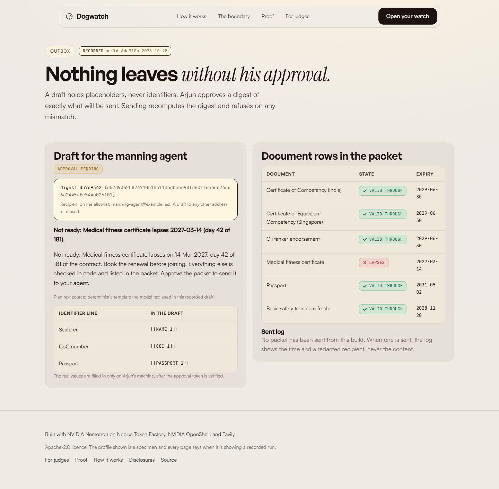
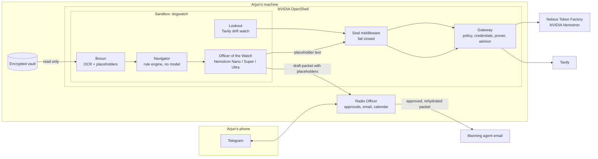

# Dogwatch

[](https://github.com/0xkinno/dogwatch/actions/workflows/ci.yml)
[](LICENSE)

**Dogwatch is an always-on, private assistant that keeps a seafarer's certificates under his control and has every renewal ready before a lapse costs him a contract.**


It is 04:10 on the four-to-eight watch in the Arabian Sea. Arjun Menon, Second Officer on a product tanker, has twenty minutes of ship internet a day. His manning agent has just offered him six months of work from 1 February, and his medical certificate expires on 14 March. He would learn that at the agency desk, where the job would go to someone else.

Dogwatch reads his certificates on his own machine, computes every expiry and sea-service window in code, and drafts the renewal packet. It answers inside his twenty minutes: not ready, the medical lapses on day 42 of 181, book it before joining, and a packet for the agent is ready to approve. He approves on Telegram, and only then does anything that identifies him leave his machine.

The assistant works with placeholders. The cloud model sees `[[COC_1]]`, never a certificate number. A gateway outside the agent allows four destinations, and a middleware called the Seal refuses any request that carries a vault value, even in an encoded form.

| | |
|---|---|
| Live app | not deployed yet; see [Run it](#run-it) |
| For judges | [JUDGE.md](JUDGE.md) |
| Demo video | not recorded yet |
| Track | Personal AI |
| Built with | NVIDIA Nemotron on Nebius Token Factory, NVIDIA OpenShell, Tavily |

## Product screenshots

| | |
|---|---|
|  |  |
|  |  |

The Telegram approval screenshot is pending: the bot has not been run with a token yet.

## The problem

Arjun's moment, in present tense. A manning agent messages him: six months, joining 1 February. His medical fitness certificate expires 14 March. Nothing on the ship tells him, and the only person who will notice is the agent, after the offer has gone to someone else.

| What is true | Source | Retrieved |
|---|---|---|
| The 2021 BIMCO and ICS report counted a current shortfall of <!--fact:need.officer_shortfall-->26,240<!--/fact--> STCW certified officers. | [press release reprint](https://www.hellenicshippingnews.com/?p=880386) (the [ICS page](https://www.ics-shipping.org/?p=12692) refused automated access) | 2026-10-28 |
| Certificates required by the Convention must be carried in original form on board. | [AMSA Marine Notice 2025/05](https://www.amsa.gov.au/sites/default/files/2025-05-Marine-notice-revalidation-Australian-STCW-certificates.pdf) | 2026-10-28 |
| STCW certificates are revalidated at intervals not exceeding five years. | [IMO STCW supplement, Regulation I/11](https://law.resource.org/pub/us/cfr/ibr/inc/imo/imo.stcw.supp.2017.pdf) | 2026-10-28 |
| The ILO minimum monthly basic wage for an able seafarer is US$<!--fact:need.ilo_wage-->704<!--/fact--> from 1 January 2027, so six months is US$<!--fact:need.contract_floor-->4224<!--/fact-->. A floor, not Arjun's wage. | [ILO](https://www.ilo.org/resource/news/subcommittee-wages-seafarers-reaches-agreement-increase-seafarer-minimum) | 2026-10-28 |

India DG Shipping and Singapore MPA sources could not be read from the build machine, so those packs ship no rules. See [MOMENT.md](MOMENT.md).

## What Dogwatch does

1. Arjun forwards the offer to Dogwatch on Telegram.
2. The Navigator checks every document against the contract window, in code.
3. It replies inside his window with the verdict, the rule and the day count.
4. He photographs discharge-book stamps; the ledger updates.
5. He approves the packet by its digest. The Radio Officer fills in real values on his machine and emails the manning agent, and adds the booking window to his calendar.

The artifact is the renewal packet and a `.ics` booking file. Arjun photographs and approves; what always reaches him is a lapse on an offered contract and any approval request.

## Explore in 2 minutes

Open [JUDGE.md](JUDGE.md). Offline, with no keys:

```bash
python -m venv .venv && . .venv/bin/activate
pip install -r requirements.txt
(cd core && python -m pytest -q)
python eval/run_seal_corpus.py
python scripts/check_facts.py
```

## Architecture



```
SEAFARER'S MACHINE (WSL2 Ubuntu or Linux, Docker)
+-----------------------------------------------------------------------------------+
| OpenShell gateway  (policy, provider credentials, prover, advisor, middleware)   |
|   +-- Sandbox "dogwatch"  (read-only vault mount, no other network)              |
|   |     Bosun -> Navigator -> Officer of the Watch -> Lookout                     |
|   |   allowed egress:  api.tokenfactory.nebius.com  POST /v1/chat/completions     |
|   |                    api.tavily.com               POST /search, /extract        |
|   |                    host.openshell.internal:8787  (Radio Officer API only)     |
|   |                    policy.local                 (advisor, built in)           |
|   +-- Seal middleware (fail_closed) on every allowed endpoint                     |
| Radio Officer (host process): Telegram bot, email, .ics, approval tokens          |
| Encrypted vault: document images, identifier table                                |
+-----------------------------------------------------------------------------------+
HOSTED JUDGE DOOR: the same Navigator, Bosun and Lookout code on the specimen profile.
It is not the sandboxed product.
```

## Product flow


## NVIDIA OpenShell

What is used, where, and its state (full table in [SDK_SURFACE.md](SDK_SURFACE.md)):

| Primitive | Where | State |
|---|---|---|
| Policy prover | `openshell/scripts/prove.sh`, `evidence/prover/` | LIVE RUN on the build machine (release 0.1.6) |
| Policy schema and L7 rules | `openshell/policy/dogwatch.yaml` | LOCAL BUILD, checked by the prover, not applied to a running sandbox |
| Provider profile for Token Factory | `openshell/profiles/nebius-token-factory.yaml` | WRITTEN, lint and import NOT RUN |
| Supervisor middleware (the Seal) | `seal/seal/server.py` | LOCAL BUILD over gRPC, registration in a gateway NOT RUN |
| Sandbox, credential placeholders, policy advisor | `openshell/scripts/up.sh` | NOT RUN, the gateway has not been started on the build machine |

Prover results: the declared policy is within the boundary, <!--fact:p1.exceeds-->3<!--/fact--> of <!--fact:p1.attack_proposals-->5<!--/fact--> attack proposals exceed it with a counterexample, <!--fact:p1.unsupported-->1<!--/fact--> is refused as unsupported and <!--fact:p1.within-->1<!--/fact--> is within the boundary because OpenShell never authorizes a link-local destination. Details in [PLATFORM_PROBE.md](PLATFORM_PROBE.md).

## NVIDIA Nemotron on Nebius Token Factory

Routing by job: Nano for triage and drift reading, Super for structuring, Ultra with a capped reasoning budget only when a verdict needs a plan. Thinking is off for extraction. Every call writes a receipt with the response id, tokens, latency and cost. The client, routing and receipts are written and tested against a fake client; **no live Token Factory call has been made yet**, so model ids are marked unconfirmed and no cost figure is shown. See the [probe](PLATFORM_PROBE.md).

## Tavily

The Lookout runs weekly: Search with the domain restricted to an administration's site, Extract for new pages, then gates on domain, keyword and a verified quote. It yields review items only and states `DRIFT_UNAVAILABLE` when Tavily fails. A test asserts no vault value, name or placeholder is ever in a Tavily request. Live Tavily calls: NOT RUN yet.

## What a model may and may not do

May: classify a message, structure placeholder text into fields with a quote that code verifies, write prose around locked value tokens, read a regulator page and quote it.
May not: decide validity, compute a date or count, write a digit Arjun will act on, see a raw identifier, change a rule pack.

## What is live, substituted, designed

| Service | State |
|---|---|
| Navigator, vault, Bosun logic, Radio Officer, Seal, Lookout logic | LOCAL BUILD, tested |
| OpenShell prover | LIVE RUN |
| OpenShell sandbox, advisor | NOT RUN |
| Nebius Token Factory, Nemotron | NOT RUN |
| Tavily | NOT RUN |
| Telegram, email | NOT RUN with real accounts; tested with fake transports |
| NemoClaw, Hermes, Nebius Serverless | NOT USED, not claimed |
| Hosted judge door host | substitute host, labelled on every response |

## Measured

All numbers are generated from `eval/results/` into `docs/FACTS.json`. Sets are built by this project, pre-registered (SHA-256 in [PROOF.md](PROOF.md)), and are internal measurements.

- Encoding corpus: a literal-only guard let through <!--fact:p3.literal.missed-->158<!--/fact--> of <!--fact:p3.attacks-->200<!--/fact--> encoded attacks. The first version of the Seal missed <!--fact:p3.seal_v1.missed-->8<!--/fact-->; the second version missed <!--fact:p3.seal.missed-->0<!--/fact--> with <!--fact:p3.seal.false_blocks-->0<!--/fact--> false blocks, reached by fixing the first run's misses on the same cases, so it is a regression check.
- Navigator against an independent oracle: <!--fact:p6.engine.correct-->60<!--/fact--> of <!--fact:p6.profiles-->60<!--/fact--> synthetic profiles. Not the headline. The Nemotron comparison on the same profiles is NOT RUN.
- Restart with a pending approval: <!--fact:p11.sends-->1<!--/fact--> send and <!--fact:p11.duplicates-->0<!--/fact--> duplicates, on a local capture transport.

NOT RUN: P2 injected inbox, P4 fail closed, P5 credential placeholder, P6 against Nemotron, P8 reading, P9 drift, P10 unattended, P12 cost.

## The finding

Administrations count sea service differently, and the sources read here do not state which convention applies. Of <!--fact:p7.histories-->60<!--/fact--> histories near the thresholds, <!--fact:p7.flips-->7<!--/fact--> change verdict with the counting convention. The engine returns Ask administration there. The second finding, that a literal guard misses most encodings, is in the corpus above.

## Recovery

Restart: a pending approval resumes, and the draft's idempotency key and an atomic send claim stop a second send. Model down: the plan falls back to a deterministic template, labelled. Tavily down: `DRIFT_UNAVAILABLE`, never "no change". Middleware down: OpenShell blocks traffic when a `fail_closed` middleware fails; the live test is NOT RUN.

## Why I built it

I am pursuing STCW certification myself. My own Basic Safety Training certificates, stored only on my machine and never committed or shown, were the first real vault Dogwatch was meant to watch.

## What existed before

Nothing. The repository starts in the submission period.

## Run it

Hosted: not deployed yet. Local without keys (recorded mode): see [Explore](#explore-in-2-minutes). Web: `cd web && npm install && npm run build && npm start`. Full stack with OpenShell: copy `.env.example` to `.env`, fill the keys, then `bash openshell/scripts/up.sh` inside WSL2 or Linux with Docker.

## Feedback for Nebius and NVIDIA

See [FRICTION.md](FRICTION.md).

## Disclosures

AI assistance, specimens, synthetic data and the image source are in [DISCLOSURES.md](DISCLOSURES.md). Evidence states are in [EVIDENCE.md](EVIDENCE.md).

## Repository map

`core/` engine, `radio/` host side, `seal/` middleware, `openshell/` policy and profiles, `skills/` six SKILL.md folders, `eval/` cases and results, `evidence/`, `web/` app, `scripts/`. Also [TASK.md](TASK.md), [PROGRESS.md](PROGRESS.md), [MILESTONES.md](MILESTONES.md), [PROOF.md](PROOF.md), [SDK_SURFACE.md](SDK_SURFACE.md), [PLATFORM_PROBE.md](PLATFORM_PROBE.md), [FRICTION.md](FRICTION.md), [JUDGE.md](JUDGE.md), [DISCLOSURES.md](DISCLOSURES.md).

License: Apache-2.0.
