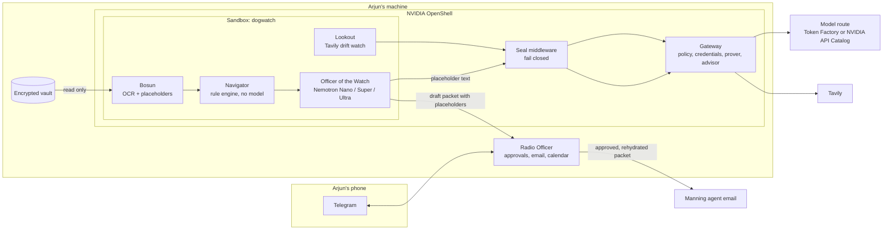
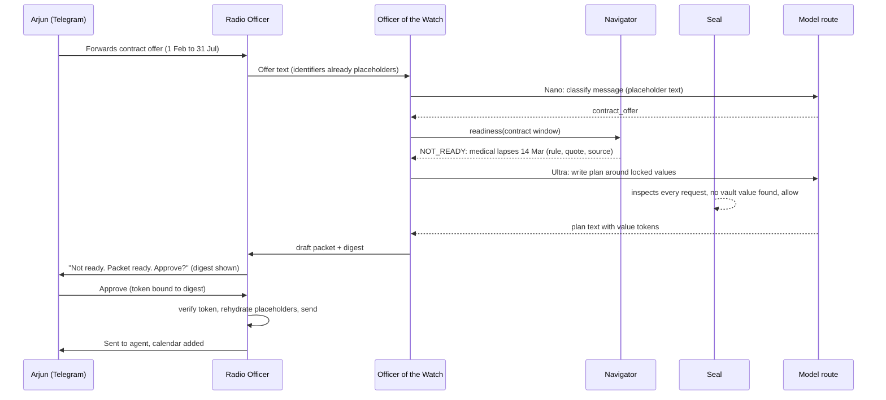

# Dogwatch

[](https://github.com/0xkinno/dogwatch/actions/workflows/ci.yml)
[](https://github.com/0xkinno/dogwatch/actions/workflows/no-claude-attribution.yml)
[](LICENSE)

**Dogwatch is an always-on, private assistant that keeps a seafarer's certificates under his control and has every renewal ready before a lapse costs him a contract.**


It is 04:10 on the four-to-eight watch in the Arabian Sea. Arjun Menon, Second Officer on a product tanker, has twenty minutes of ship internet a day. His manning agent has just offered him six months of work from 1 February, and his medical certificate expires on 14 March. He would learn that at the agency desk, where the job would go to someone else.

Dogwatch reads his certificates on his own machine, works out every expiry and sea-service window in code, and drafts the renewal packet. It answers inside his twenty minutes: not ready, the medical lapses on day 42 of 181, book it before joining, and a packet for the agent is ready to approve. He approves on Telegram, and only then does anything that identifies him leave his machine.

The idea underneath is simple. An assistant does not have to see your documents to help with them. The cloud model gets placeholders such as `[[COC_1]]`. A gateway outside the agent allows four destinations. A middleware called the Seal refuses any request that carries a vault value, even one that has been encoded. And no model is ever allowed to decide whether a certificate is valid, because on the same sixty profiles a model on its own said READY when it was not.

| | |
|---|---|
| Live app | [dogwatch-eight.vercel.app](https://dogwatch-eight.vercel.app), API host [dogwatch-api.vercel.app](https://dogwatch-api.vercel.app/api/status) (Vercel, a substitute host: the product itself runs on the seafarer's machine) |
| For judges | [JUDGE.md](JUDGE.md) |
| Demo video | not recorded yet |
| Track | Personal AI |
| Built with | NVIDIA Nemotron (Nebius Token Factory is the submission target, see [Routes](#which-route-produced-which-result)), NVIDIA OpenShell, Tavily |

## Product screenshots

All are 1440 by 900 captures of the running app, taken by Playwright (`web/tests/shots.spec.ts`).

| | |
|---|---|
|  |  |
|  |  |

The Telegram approval screenshot is pending: the bot is built and tested against a fake transport, and the first live message needs the owner to open the bot once.

## The problem

Arjun's moment, in present tense. A manning agent messages him: six months, joining 1 February. His medical fitness certificate expires 14 March. Nothing on the ship tells him, and the only person who will notice is the agent, after the offer has gone to someone else.

| What is true | Source | Retrieved |
|---|---|---|
| The 2021 BIMCO and ICS report counted a current shortfall of <!--fact:need.officer_shortfall-->26,240<!--/fact--> STCW certified officers. | [press release reprint](https://www.hellenicshippingnews.com/?p=880386) (the [ICS page](https://www.ics-shipping.org/?p=12692) refused automated access) | 2026-10-28 |
| Certificates required by the Convention must be carried in original form on board. | [AMSA Marine Notice 2025/05](https://www.amsa.gov.au/sites/default/files/2025-05-Marine-notice-revalidation-Australian-STCW-certificates.pdf) | 2026-10-28 |
| STCW certificates are revalidated at intervals not exceeding five years. | [IMO STCW supplement, Regulation I/11](https://law.resource.org/pub/us/cfr/ibr/inc/imo/imo.stcw.supp.2017.pdf) | 2026-10-28 |
| The ILO minimum monthly basic wage for an able seafarer is US$<!--fact:need.ilo_wage-->704<!--/fact--> from 1 January 2027, so six months is US$<!--fact:need.contract_floor-->4224<!--/fact-->. A floor, not Arjun's wage. | [ILO](https://www.ilo.org/resource/news/subcommittee-wages-seafarers-reaches-agreement-increase-seafarer-minimum) | 2026-10-28 |

India DG Shipping and Singapore MPA sources could not be read from the build machine (the host refused connections, and the MPA page returned 404), so those packs ship no rules and the engine answers Ask administration for anything that needs them. See [MOMENT.md](MOMENT.md).

## What Dogwatch does

1. Arjun forwards the offer to Dogwatch on Telegram.
2. The Navigator checks every document against the contract window, in code.
3. It replies inside his window with the verdict, the rule and the day count.
4. He photographs discharge-book stamps and the ledger updates.
5. He approves the packet by its digest. The Radio Officer fills in real values on his machine, emails the manning agent and adds the booking window to his calendar.

What always reaches him: a lapse on an offered contract, and any approval request. Everything else waits inside a budget of two questions a day.

## Explore in 2 minutes

Open [JUDGE.md](JUDGE.md). Offline, with no keys:

```bash
python -m venv .venv && . .venv/bin/activate
pip install -r requirements.txt
(cd core && python -m pytest -q)
python eval/run_seal_corpus.py
python scripts/check_facts.py
```

## Architecture



```
SEAFARER'S MACHINE (Linux 6.2 or newer with Docker, or WSL2 on a recent kernel)
+-----------------------------------------------------------------------------------+
| OpenShell gateway  (policy, provider credentials, prover, advisor, middleware)   |
|   +-- Sandbox "dogwatch"  (read-only vault mount, no other network)              |
|   |     Bosun -> Navigator -> Officer of the Watch -> Lookout                     |
|   |   allowed egress:  model route (one of two hosts)  POST /v1/chat/completions  |
|   |                    api.tavily.com               POST /search, /extract        |
|   |                    host.openshell.internal:8787  (Radio Officer API only)     |
|   |                    policy.local                 (advisor, built in)           |
|   +-- Seal middleware (fail_closed) on every allowed endpoint                     |
| Radio Officer (host process): Telegram bot, email, .ics, approval tokens          |
| Encrypted vault: document images, identifier table                                |
+-----------------------------------------------------------------------------------+
HOSTED JUDGE DOOR: the same Navigator, Bosun and Lookout code on the specimen profile.
It is not the sandboxed product.
```

## Product flow



## Which route produced which result

Nebius Token Factory is the submission target. Its API key is not available to this project (the promotional credit could not be claimed because of card restrictions), so every live model result in this repository ran on the **NVIDIA API Catalog (development route)**, which serves the same Nemotron families. That route is chosen by `MODEL_ROUTE` in `core/dogwatch/model/routes.py`: Token Factory is the default whenever `NEBIUS_API_KEY` exists, `nvidia_build` otherwise. Exactly those two hosts are allowed, and `core/tests/test_provider_integrity.py` fails the build if any other inference host appears in the code.

| Result | Route |
|---|---|
| Probe, P6 against Nemotron, P8, P9, P10, P12 | Route: NVIDIA API Catalog (development) |
| Anything on Nebius Token Factory | NOT RUN, `bash scripts/switch_to_tokenfactory.sh` re-runs the probe, P6, P8 and P12 the moment a key exists |

Every receipt records its route, `/api/status` reports it, the UI prints it next to each result, and every result file carries `route_label`. A run on one route is never described as a run on the other. Model ids differ between the routes and are confirmed from `GET /models` on each, not assumed.

## NVIDIA OpenShell

What ran, on this machine, and what did not (full table in [SDK_SURFACE.md](SDK_SURFACE.md)):

| Primitive | State |
|---|---|
| Policy prover (`openshell-prover`, release 0.1.6) | LIVE RUN. The declared policy is within the boundary; <!--fact:p1.exceeds-->3<!--/fact--> of <!--fact:p1.attack_proposals-->5<!--/fact--> attack proposals exceed it with a counterexample, <!--fact:p1.unsupported-->1<!--/fact--> is refused as unsupported, <!--fact:p1.within-->1<!--/fact--> is within the boundary because OpenShell never authorizes a link-local destination |
| Gateway, provider profile, Seal registration | LIVE RUN. The gateway started, the stock NVIDIA profile linted, imported and became a provider, the Seal registered and the gateway log names it, and a policy that referenced the Seal before registration was refused |
| Dogwatch sandbox image | LIVE RUN (built) |
| The sandbox itself, policy advisor, P2, P4, P5 | NOT RUN. The supervisor starts and exits before it is ready. OpenShell requires the Landlock LSM at ABI 3, introduced in Linux 6.2, and this WSL kernel is 5.10 |
| Prover on the sandbox's effective policy | NOT RUN, needs the sandbox. The declared policy was checked instead |

Getting this far took two workarounds that are written up in [FRICTION.md](FRICTION.md): the installer cannot restart the gateway on WSL without systemd, and the Docker driver needs Engine 28 or newer (the machine had 27.1.1), so a second isolated 28.0.4 daemon ran on its own socket.

## NVIDIA Nemotron

Routing by job: Nano for triage and drift reading, Super for structuring, Ultra with a capped reasoning budget when a verdict needs a plan. Thinking is off for extraction. On one real extraction, thinking on used about ten times the tokens and time of thinking off (probe in `evidence/probe/nvidia_build.json`). JSON schema was enforced server side on that route in three of three trials, and a reply wrapped in prose or code fences still parses because the client extracts the first JSON object and allows one repair retry.

Models answering chat on the development route today: `nvidia/nemotron-3-nano-omni-30b-a3b-reasoning`, `nvidia/nemotron-3.5-super-vl-120b-a12b` and `nvidia/nemotron-3-ultra-550b-a55b`. The catalog also lists `nvidia/nemotron-3-super-120b-a12b`, which returned HTTP 404 when called, so the id list alone is not trusted.

## Tavily

The Lookout runs weekly: search restricted to an administration's domain, extract for new pages, then gates on domain, keyword and a quote that code verifies. It produces review items only and states `DRIFT_UNAVAILABLE` when Tavily fails. A test asserts that no vault value, name or placeholder is ever in a Tavily request. Live run (P9): <!--fact:p9.requests-->52<!--/fact--> Tavily requests, <!--fact:p9.searched-->49<!--/fact--> pages returned, <!--fact:p9.classified-->29<!--/fact--> classified, <!--fact:p9.items-->27<!--/fact--> review items. There is no ground truth for new rule text, so this reports behaviour and gates, not accuracy; the high item count shows the classifier is eager and a person reviews each one.

## What a model may and may not do

May: classify a message, structure placeholder text into fields with a quote that code verifies, write prose around locked value tokens, read a regulator page and quote it.
May not: decide validity, compute a date or a count, write a digit Arjun will act on, see a raw identifier, change a rule pack.

## What is live, substituted, designed

| Service | State |
|---|---|
| Navigator, vault, Bosun, Radio Officer, Seal, Lookout logic | LOCAL BUILD, tested (132 tests across three packages) |
| Nemotron on the NVIDIA API Catalog | LIVE RUN (development route) |
| Nemotron on Nebius Token Factory | NOT RUN, no key |
| Tavily | LIVE RUN |
| OpenShell prover, gateway, Seal registration | LIVE RUN |
| OpenShell sandbox, advisor | NOT RUN, kernel below Landlock ABI 3 |
| Telegram | bot verified (`getMe`), first message NOT RUN until the owner opens the bot |
| Email | NOT RUN. Gmail SMTP is blocked on this network, and Resend needs a key |
| NemoClaw, Hermes, Nebius Serverless | NOT USED, not claimed |
| Hosted judge door host | substitute host, labelled on every response |

## Measured

All numbers are generated from `eval/results/` into `docs/FACTS.json`. Sets are built by this project, pre-registered (SHA-256 in [PROOF.md](PROOF.md)), and are internal measurements. Misses stay in the denominator.

**The model on its own got it wrong** (P6, Route: NVIDIA API Catalog (development), thinking off, rule text supplied, <!--fact:p6.profiles-->60<!--/fact--> synthetic profiles with verdicts written by an independent oracle before the run):

| Contestant | Correct | Said READY when it was not | False alarms |
|---|---|---|---|
| Navigator (code, no model) | <!--fact:p6.engine.correct-->60<!--/fact--> | <!--fact:p6.engine.false_safe-->0<!--/fact--> | 0 |
| Nemotron Super alone | <!--fact:p6.super.correct-->30<!--/fact--> | <!--fact:p6.super.false_safe-->22<!--/fact--> | <!--fact:p6.super.false_alarm-->0<!--/fact--> |
| Nemotron Ultra alone | <!--fact:p6.ultra.correct-->47<!--/fact--> | <!--fact:p6.ultra.false_safe-->0<!--/fact--> | <!--fact:p6.ultra.false_alarm-->8<!--/fact--> |

The Navigator's own score is on a set this project built, so it is not the headline. The headline is that the smaller model said READY on 22 profiles that were not ready, and the larger one stopped doing that only by raising alarms on 8 that were fine.

**Reading specimens** (P8, same route): <!--fact:p8.exact-->39<!--/fact--> of <!--fact:p8.specimens-->40<!--/fact--> rendered certificates read with the exact expiry date, <!--fact:p8.unread-->1<!--/fact--> left UNREAD, <!--fact:p8.wrong_confident-->0<!--/fact--> wrong without a flag. OCR runs locally; every outgoing request body was scanned for the synthetic identifiers: <!--fact:p8.leaks-->0<!--/fact--> found in <!--fact:p8.bodies-->40<!--/fact--> bodies. The first run found <!--fact:p8.v1_leaks-->12<!--/fact--> leaks (OCR split numbers with spaces, and the holder's name has no pattern), the detectors were fixed, and both result files are committed.

**Encoding corpus** (P3, local): a literal-only guard let through <!--fact:p3.literal.missed-->158<!--/fact--> of <!--fact:p3.attacks-->200<!--/fact--> encoded attacks. The first Seal missed <!--fact:p3.seal_v1.missed-->8<!--/fact--> (base64 tokens under the 12 character minimum the notes specified); the second missed <!--fact:p3.seal.missed-->0<!--/fact--> with <!--fact:p3.seal.false_blocks-->0<!--/fact--> false blocks, reached by fixing the misses on the same cases, so it is a regression check and not an independent score.

**Unattended** (P10): the timer loop ran <!--fact:p10.daily-->1<!--/fact--> daily and <!--fact:p10.weekly-->1<!--/fact--> weekly run with nobody watching, once each, and raised the medical lapse alert (`evidence/unattended/trace.json`).

**Cost** (P12): one weekly drift check across all administrations used <!--fact:p12.weekly_tokens-->49201<!--/fact--> tokens; a readiness run uses 0 because the Navigator calls no model; Ultra answered the same prompts about <!--fact:p12.latency_ratio-->2.35<!--/fact--> times slower than Super. No dollar figure is shown: the development route has no list price and a price is never invented.

**Restart** (P11, fixture transport): <!--fact:p11.sends-->1<!--/fact--> send and <!--fact:p11.duplicates-->0<!--/fact--> duplicates after a kill with an approval pending.

NOT RUN: P2 injected inbox, P4 fail closed, P5 credential placeholder (all need the sandbox), and anything on Token Factory.

## The finding

Administrations count sea service differently, and none of the sources read here states which convention applies. Of <!--fact:p7.histories-->60<!--/fact--> histories near the thresholds, <!--fact:p7.flips-->7<!--/fact--> change verdict with the counting convention, so the engine returns Ask administration there instead of guessing. The second finding is that a literal guard misses most encodings, and the third is that the identifiers most likely to leak are the ones OCR damages.

## Recovery

Restart: a pending approval resumes, and the draft's idempotency key plus an atomic send claim stop a second send. Model down or busy: HTTP 429 and 503 are retried, then the plan falls back to a deterministic template, labelled. Tavily down: `DRIFT_UNAVAILABLE`, never "no change". Middleware down: OpenShell blocks traffic when a `fail_closed` middleware fails, and a policy naming an unregistered middleware is refused at admission; the live kill test is NOT RUN.

## Why I built it

I am pursuing STCW certification myself. My own Basic Safety Training certificates, stored only on my machine and never committed or shown, were the first real vault Dogwatch was meant to watch.

## What existed before

Nothing. The repository starts in the submission period.

## Run it

Hosted: the live app above (Vercel, a substitute host, labelled in `/api/status`). Local without keys: see [Explore](#explore-in-2-minutes). Web: `cd web && npm install && npm run build && npm start`. With a model: copy `.env.example` to `.env`, set `NVIDIA_API_KEY` (development route) or `NEBIUS_API_KEY` (Token Factory), then `python scripts/probe.py`. The OpenShell stack needs a Linux 6.2 or newer kernel with Docker Engine 28 or newer: `openshell/scripts/up.sh`, with `wsl-start.sh`, `wsl-docker28.sh` and `seal-up.sh` for WSL builds.

## Feedback for Nebius and NVIDIA

See [FRICTION.md](FRICTION.md). Token Factory items are marked as not run, because no key was available.

## Disclosures

AI assistance, specimens, synthetic data and the image source are in [DISCLOSURES.md](DISCLOSURES.md). Evidence states are in [EVIDENCE.md](EVIDENCE.md).

## Repository map

`core/` engine, `radio/` host side, `seal/` middleware, `openshell/` policy, profiles and sandbox image, `skills/` six SKILL.md folders, `eval/` cases, specimens and results, `evidence/`, `web/` app, `scripts/`. Also [TASK.md](TASK.md), [PROGRESS.md](PROGRESS.md), [MILESTONES.md](MILESTONES.md), [PROOF.md](PROOF.md), [SDK_SURFACE.md](SDK_SURFACE.md), [PLATFORM_PROBE.md](PLATFORM_PROBE.md), [FRICTION.md](FRICTION.md), [JUDGE.md](JUDGE.md), [DISCLOSURES.md](DISCLOSURES.md), [SUBMISSION_DEVPOST.md](SUBMISSION_DEVPOST.md).

License: Apache-2.0.
